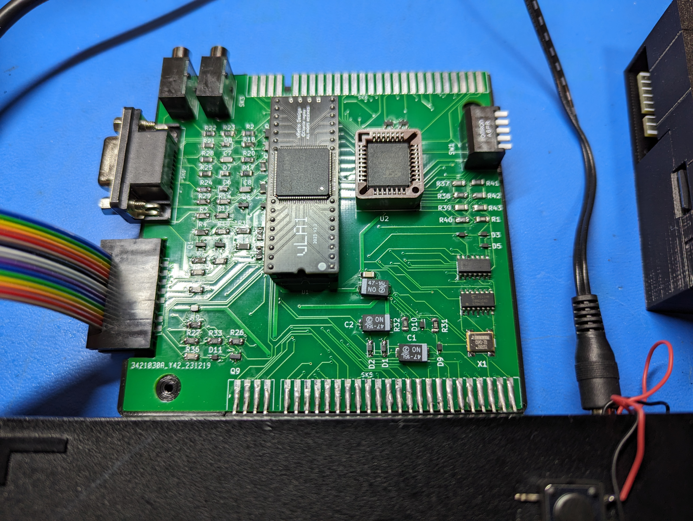

# ZX-Interface-1-Renewed-PLCC
Sinclair ZX Interface 1 recreated using a standard edge connector along with SMD components where possible along with a PLCC ROM.

The schematic available from the Service Guide was redrawn in Kicad and used to create the PCB and to verify that the routing was correct and that no components were missed.

This is the result of that exercise.

Sometimes Kicad complains that there is an issue with the edge.cuts file. Running DRC will show what it doesn't like and it's easy to fix so that the board outline is a closed shape. Currently the pcb is just small enough for JLCPCB to treat it as a prototype for lower pricing.

The file bom/ibom.html is an interactive BOM that will show component position as well as routing in a web browser.

Have fun.

Comments - Good Bad or totally indifferent on https://www.facebook.com/groups/zxspa/
